# Streamlit Dashboard Visual Guide

This guide introduces the redesigned enterprise user interface for the **Skill & Prompt Regression Manager for Local Agents**. Every page adheres to the local-first enterprise design system, featuring WCAG AA compliant dual-encoded status chips, cached system telemetry, high-contrast Plotly data visualizations, and accessible navigation.

---

### 1. System Overview (`/`)
The System Overview provides an immediate telemetry dashboard displaying the active baseline hash, gate verdict, historical pass-rate trends, recent comparisons, installed Ollama models, and model weight digest drift monitoring.
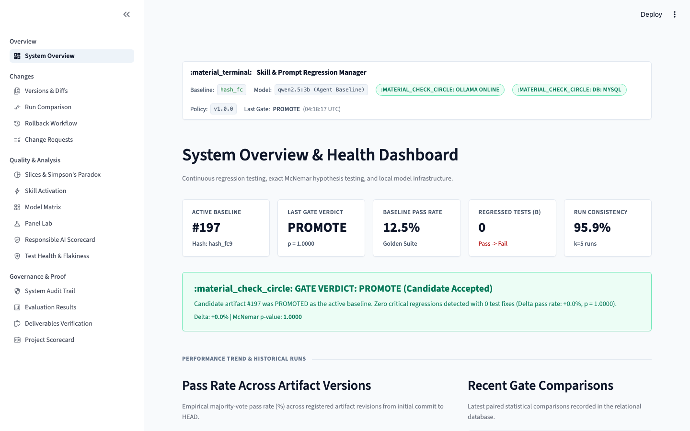

---

### 2. Versions and Diffs (`/Versions_and_Diffs`)
The Versions and Diffs view provides an immutable Git commit timeline for managed prompts and skills, a side-by-side unified diff viewer, live commit authoring, and a static quality lint engine that flags contradictory rules and injection vulnerabilities.
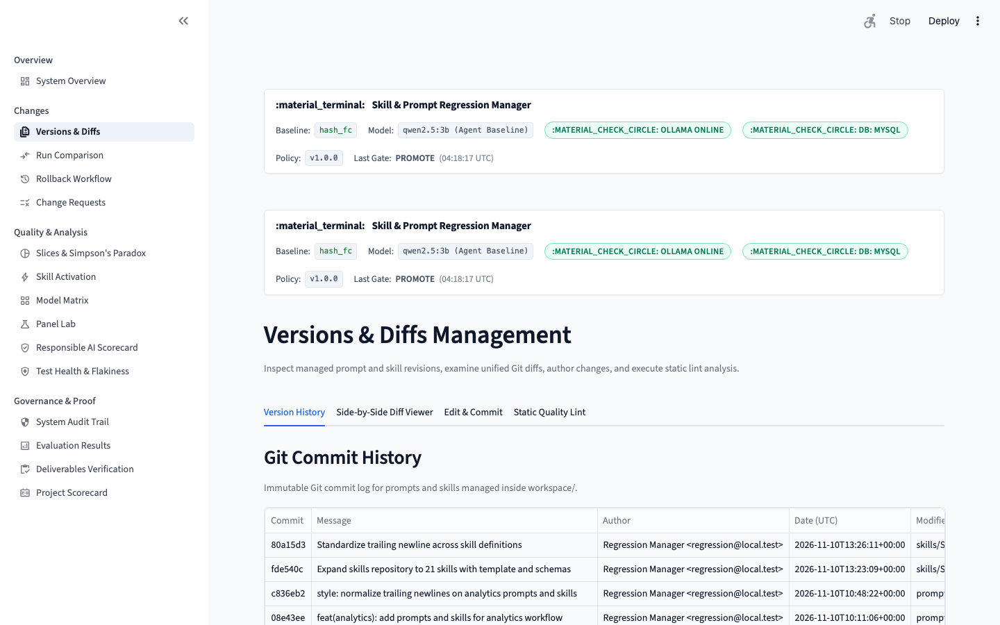

---

### 3. Run Comparison & Regression Gate (`/Run_Comparison`)
Run Comparison performs paired evaluation between baseline and candidate artifacts, evaluating exact McNemar test significance ($p < 0.05$), computing 95% bootstrap confidence intervals, and rendering sortable flip tables with side-by-side output inspection.
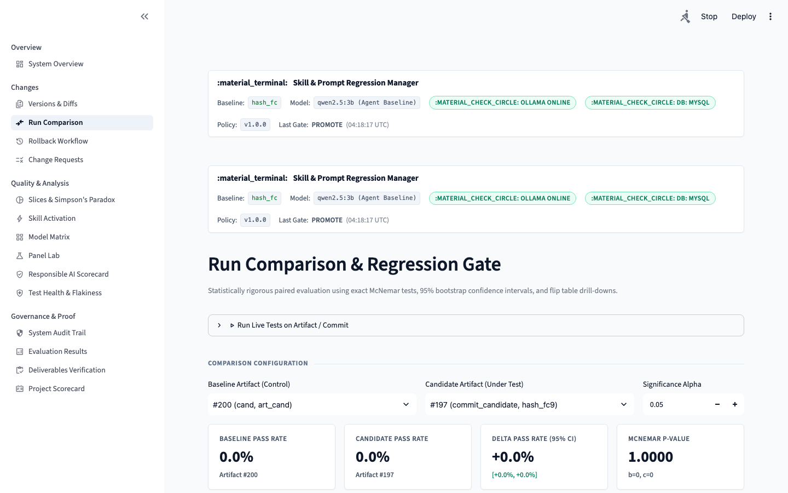

---

### 4. Slices & Simpson's Paradox Analysis (`/Slices`)
The Slices Breakdown view partitions test suites across task categories and difficulty tiers, catching localized regressions ($\Delta \le -0.10$) that are routinely hidden behind flat aggregate pass rates in composite models.
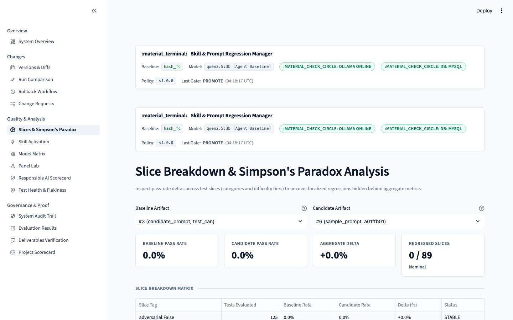

---

### 5. Skill Activation & Semantic Routing (`/Skill_Activation`)
This view benchmarks semantic routing accuracy across 120 standardized tasks, visualizes pairwise skill cosine similarity heatmaps to prevent conceptual collisions, and provides an interactive task routing inspector.
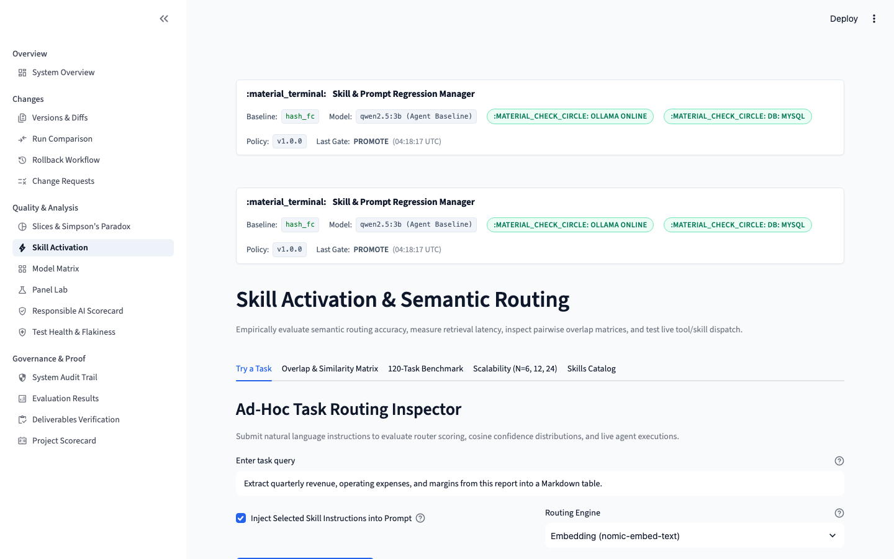

---

### 6. Evaluation Benchmark Results (`/Evaluation_Results`)
The Evaluation Results view presents quantitative comparisons of our majority-voting McNemar gating system against four industry baseline methods across 18 injected regressions and 8 benign controls with 95% bootstrap confidence intervals.
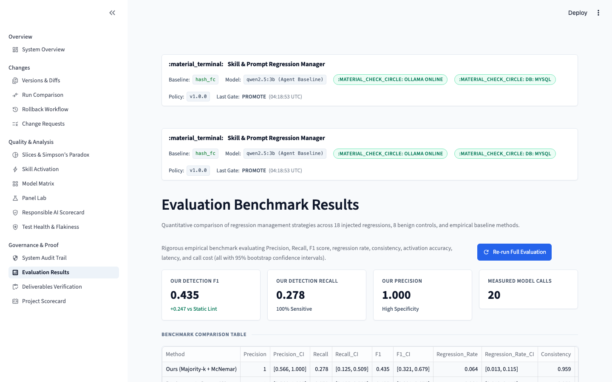

---

### 7. Rollback & Remediation Workflow (`/Rollback`)
The Rollback Workflow provides non-destructive reversion via `git revert`, displays expected metric recovery profiles, enforces a mandatory justification dialog (`st.dialog`), and validates post-rollback test suite recovery.
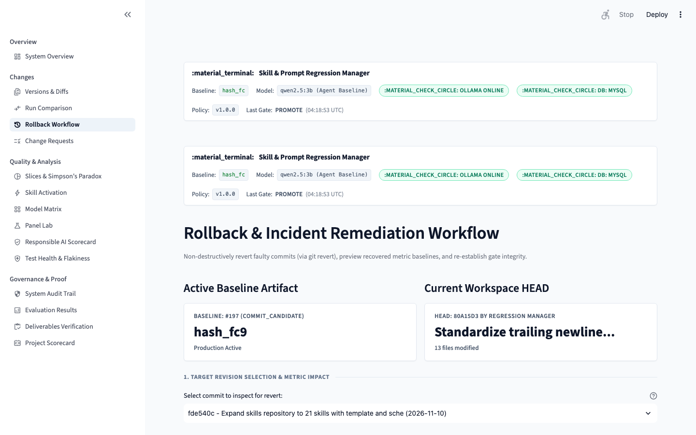

---

### 8. Change Requests & Governance Approvals (`/Change_Requests`)
Change Requests enforces multi-party governance, submitting revisions through automated regression gates and requiring authorized sign-off while enforcing strict separation of duties (authors cannot approve their own changes).
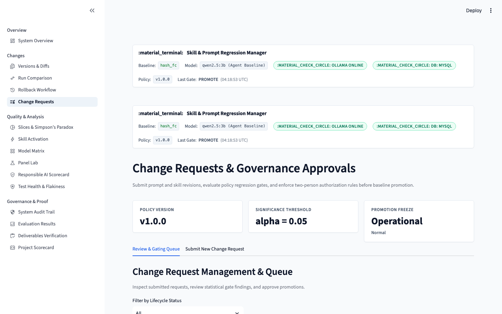

---

### 9. Cryptographic Audit Trail (`/Audit_Log`)
The Audit Log presents an append-only ledger of change requests, gate evaluations, and promotions, verified continuously by an unbroken SHA-256 cryptographic hash chain with real-time tampering detection.
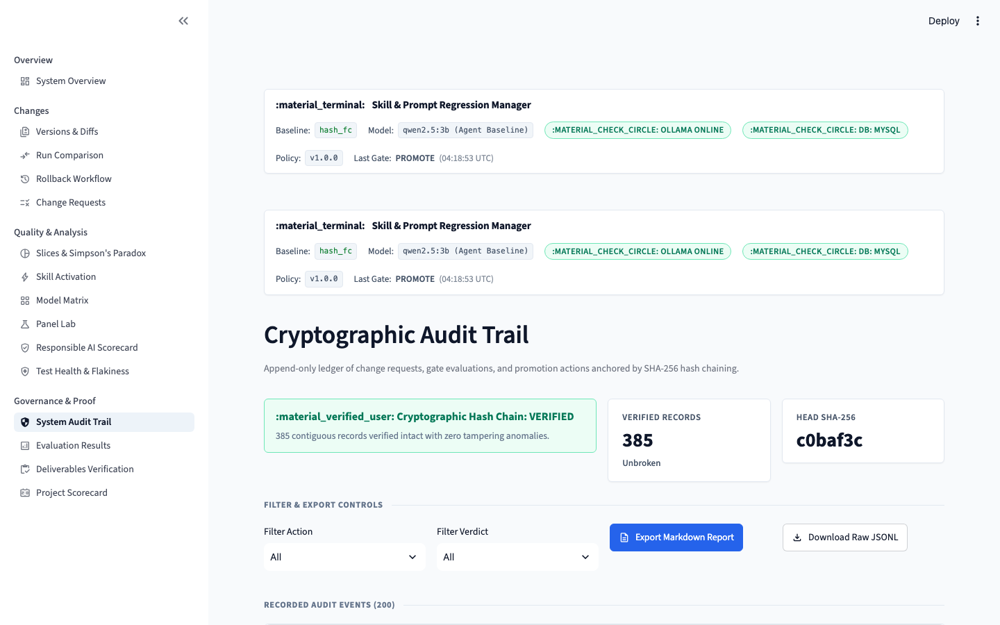

---

### 10. Multi-Model Regression Matrix (`/Model_Matrix`)
The Multi-Model Matrix evaluates candidate local weights (`llama3.2:3b`, `gemma2:2b`) against baseline (`qwen2.5:3b`), analyzing pass-rate heatmaps, latency distributions, consistency scores, and LLM judge calibration.
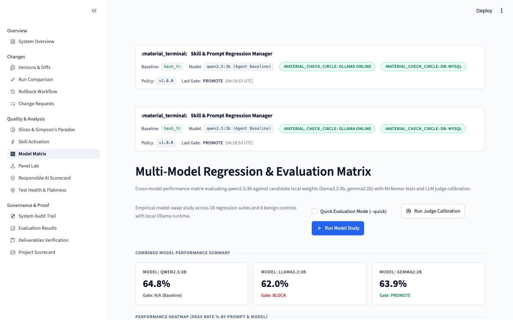

---

### 11. Panel Evaluation & Exploration Lab (`/Panel_Lab`)
Panel Lab offers a structured stepper pipeline (Input, Rules, Tests, Run, Results, Compare) for ad-hoc prompt engineering, custom rule synthesis, execution profiling, and candidate gate verification.
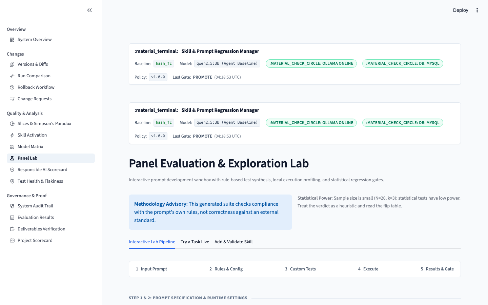

---

### 12. Responsible AI Governance Scorecard (`/Responsible_AI_Scorecard`)
The Responsible AI Scorecard tracks empirical safety measurements, including adversarial refusal rates, injection evasion success, PII leakage prevention, and counterfactual demographic parity gaps.
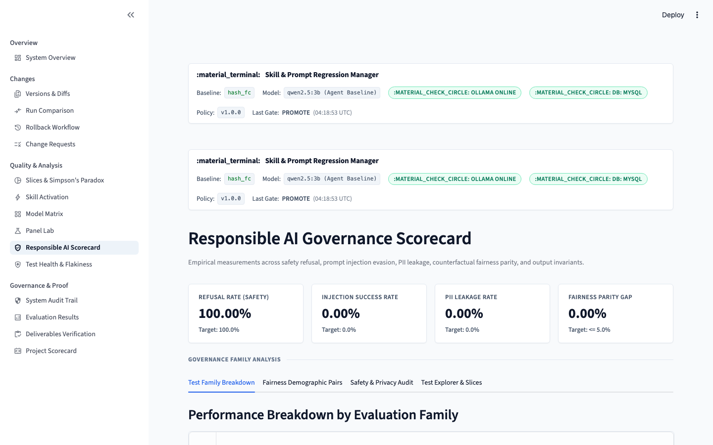

---

### 13. Test Suite Health & Flakiness Monitor (`/Test_Health`)
This view isolates stochastic flakiness (tests with 20% to 80% pass rates), automatically quarantines unstable assertions, and audits dead-weight or stale assertions against recent prompt revisions.
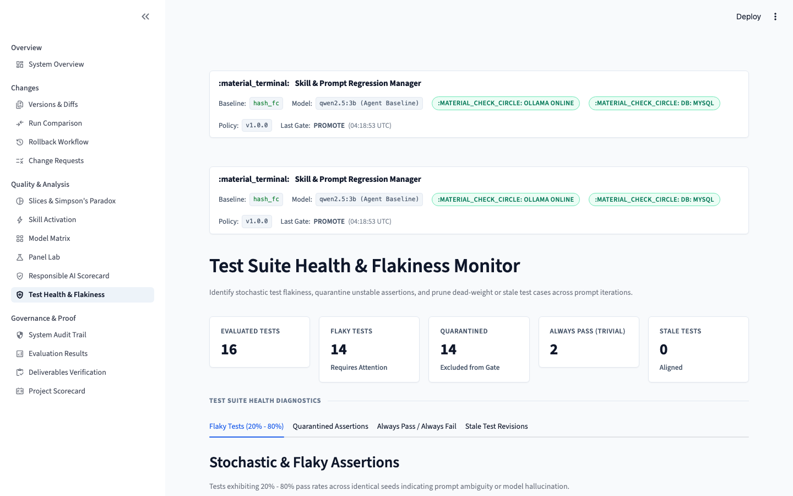

---

### 14. Project Sheet Deliverables Verification (`/Deliverables`)
The Deliverables view maps the five core requirements from the project specification to functional codebase components, providing interactive verification buttons for each module.
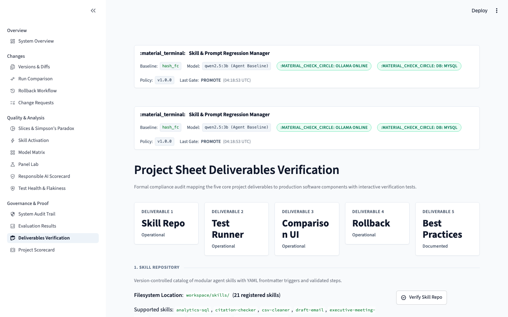

---

### 15. Project Specification Metrics Scorecard (`/Project_Scorecard`)
The Project Scorecard summarizes empirical performance across all five primary benchmark metrics (Skill-Selection Accuracy, Task Success Delta, Regression Recall, Run Consistency, and Retrieval Latency) with full citations to raw data artifacts.
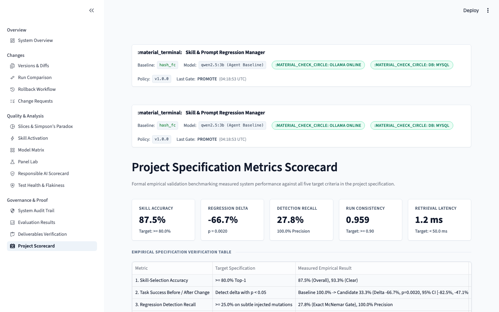
